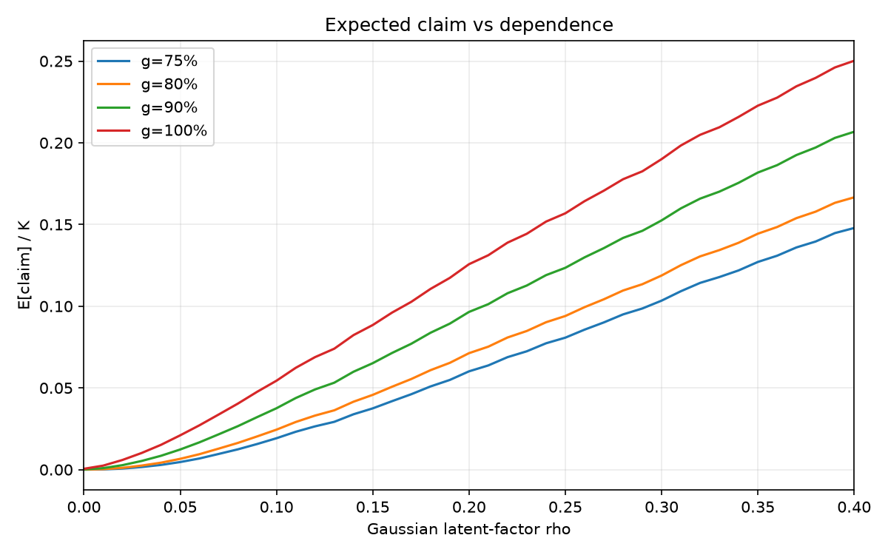

# INVARIANT MARKETS

**What if venture capital could offer extraordinary upside without exposing investors to the full downside of startup failure?**

An independent quantitative research project asks who would fund that protection,
how much loss it would transfer, and whether diversification or hypothetical
selection advantages could make it feasible. The repository contains mathematical
models, Monte Carlo code, saved simulations and a critical audit of the evidence.

**The strongest finding is a constraint:** common risk survives diversification,
and public aggregate return statistics do not identify a unique company-return
model. No risk-free investment or commercially priced guarantee is established.

[Saved numerical findings](results/coherence-v2/summary.md) ·
[Mathematical specification](docs/02_mathematical_specification.md) ·
[Reproduce and inspect](docs/REPRODUCIBILITY.md) ·
[Limitations](docs/LIMITATIONS.md)

## From venture returns to risk-bearing capital

```text
VENTURE INVESTMENTS → HIGHLY SKEWED RETURNS → PORTFOLIO DIVERSIFICATION
        → CORRELATED FAILURE MODELLING → PRINCIPAL FLOOR
        → REQUIRED RISK-BEARING CAPITAL → FEASIBILITY ANALYSIS
```

For invested principal $K$, protected fraction $g$ and terminal portfolio value
$NAV_T$, the shortfall owed by a protection provider is

$$C_T=\max(gK-NAV_T,0).$$

A floor transfers that loss to a guarantor, reserve or another risk-bearing party.
It does not remove the loss. Expected claims, tail losses, funding, liquidity,
counterparty default, fees and regulatory costs remain separate questions.
Expected claim is neither an insurance premium nor required regulatory capital.

## What was completed

| Stage | Scientific object | Evidence available here |
|---|---|---|
| S2a, synthetic prototype | Five outcome bands, dilution, shared macro states, 8 portfolio sizes × 5 floors | Source and [saved 5,000-path/grid-point baseline](results/synthetic-baseline/summary.md) |
| S2b-a, aggregate constraints | A terminal marginal constrained by rounded financing-level frequencies | Source, source registry and assumptions; not complete historical calibration |
| Selection/feasibility frontier | Hypothetical selection tilts, macro/sector dependence, large portfolios and separate platform economics | Most advanced remote branch's implementation at root; **no completed saved frontier run located** |
| Coherence/dependence V2 | Independent audit of observation units, body/tail uncertainty, dependence and missing winners | [Separate source snapshot](stages/coherence-v2/STAGE.md), [CSVs and saved figures](results/coherence-v2/summary.md) |

The V2 stage is a separate branch of the research. It is not the missing output
of the selection-frontier implementation. [Provenance](PROVENANCE.json) records
original commits without importing their personal Git metadata.

## Actual numerical findings

The synthetic S2a baseline (`N=100`, `g=75%`, seed 42) has expected portfolio
multiple **1.3769×**, claim probability **24.22%**, expected claim **8.36% of K**
and threshold-based ES99.5 **70.37% of K**. These are synthetic architecture tests.
Its original manifest records a dirty worktree; exact source reconstruction for
that historical run is not established. Do not treat it as empirical pricing.

V2's frozen marginal produces **2.3396×** gross equal-weighted mean. None of
**360** declared interpretations satisfies its joint aggregate-threshold/TVPI
compatibility criteria. Financing/deal observations can repeat companies; fund
TVPI is a different object. The mismatch cannot be assigned uniquely to fees,
weighting, censoring, duplication or tail assumptions from those aggregates.

In the saved Gaussian-dependence screening comparison, at `N=1,000` and a
**100% floor**:

| Latent Gaussian factor parameter ρ | Expected claim / K | Claim probability | ES99.5 / K |
|---:|---:|---:|---:|
| 0.00 | 0.00% | 0.00% | 0.00% |
| 0.10 | 3.55% | 14.30% | 69.93% |
| 0.20 | 11.00% | 28.88% | 90.90% |
| 0.30 | 18.35% | 37.96% | 96.48% |
| 0.40 | 24.00% | 43.64% | 99.24% |

These are **5,000-path screening estimates under unfitted dependence scenarios**.
ρ is not a measured startup-return correlation. A zero simulated claim is not
proof of zero loss probability. At ρ=0.20, doubling N from 1,000 to 2,000 lowers
expected claim only from **11.00% to 10.87%**. All values come from the unchanged
[saved CSV](results/coherence-v2/dependence_frontier.csv) and
[size comparison](results/coherence-v2/portfolio_size_saturation.csv).

The original V2 figure below uses **N=100**, whereas the table above uses
N=1,000. Both are unfitted 5,000-path screening scenarios.



## Inspect the evidence

The saved outputs retain seeds, effective configurations, manifests, validation
records, source audits, Monte Carlo uncertainty and authentic plots. The root
source preserves the selection-frontier design and its existing tests; the
separate V2 snapshot makes the completed critical analysis inspectable.

[Empirical source audit](docs/empirical_calibration/00_overview.md) ·
[Selection-frontier methods](docs/selection_frontier/00_overview.md) ·
[V2 summary and figures](results/coherence-v2/summary.md) ·
[Original assumptions](ASSUMPTIONS.md)

## Reproduce

Use Python 3.14 and install each stage in a separate environment:

```bash
python3.14 -m venv .venv
source .venv/bin/activate
python -m pip install -e '.[test]'
python -m pytest
```

This runs lightweight tests, not the full frontier. See
[reproducibility instructions](docs/REPRODUCIBILITY.md) for the separate V2
installation, verification of archived files, and optional research commands.
Large simulation commands are explicitly opt-in.

## Limits and future validation

The model does not establish selection skill, investor demand, insurer solvency,
market pricing, legal feasibility or regulatory capital adequacy. IPO freezes
and crashes are scenario risks, not fitted forecasts; the event-driven engine
is a prototype and historical bootstrap is an interface only. A licensed
company/check-level panel with dated cash flows and censoring is the central
missing empirical input. Future tests should estimate dependence and out-of-sample
selection performance before making a viability claim.

## Citation and reuse

Maintained by [@MoheetBrain](https://github.com/MoheetBrain).
Use [CITATION.cff](CITATION.cff) and cite the exact public commit. Original code:
[MIT](LICENSE). Original research/figures/results: CC BY 4.0, with the source-data
exceptions in [DATA_LICENSE.md](DATA_LICENSE.md). Forks and pull requests are
welcome; changes to this repository require maintainer authorization.
